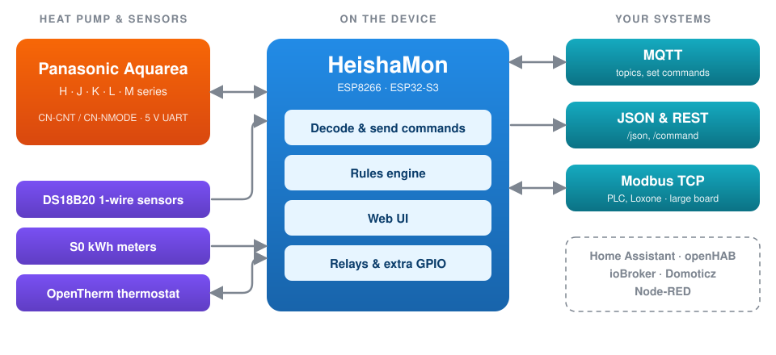

<h1 align="center">HeishaMon</h1>

  <b>Read, control and automate your Panasonic Aquarea heat pump</b> 
  over MQTT, JSON/HTTP and Modbus TCP, with an on-device rules engine.

  
  
  
  

  

HeishaMon is firmware for ESP8266 (small PCB) and ESP32-S3 (large PCB) boards that speaks the serial protocol of the Panasonic Aquarea **H, J, K, L and M series**. It decodes everything the heat pump reports, republishes it, and lets you send commands back. [Heat pump types confirmed by users](HeatPumpType.md).

## Highlights

- **MQTT:** every value on its own topic, settable values through command topics. [Topics](MQTT-Topics.md)
- **JSON and REST:** one JSON document with all values, single-value queries and a `/command` endpoint. [JSON output](docs/json-api.md)
- **Rules engine:** automate the heat pump on the device itself, no external server or WiFi round trip needed. [Rules](docs/rules.md)
- **Modbus TCP** (large board): read values and, if enabled, write commands from a PLC or Loxone. [Modbus](docs/modbus.md)
- **Sensors:** DS18B20 1-wire temperatures with calibration offset and two S0 kWh meters. [Sensors](docs/sensors.md)
- **Relays and GPIO** (large board): two relays plus configurable extra GPIOs, with restore at boot. [GPIO and relays](docs/gpio-relays.md)
- **OpenTherm:** bridge an OpenTherm thermostat to the heat pump. [OpenTherm](docs/opentherm.md)
- **Web UI:** live values, settings, rules editor and firmware update in the browser.

## Quick start

1. **Download** the firmware from the [releases](https://github.com/Egyras/HeishaMon/releases): the *small* binary for the ESP8266 board, the *large* one for the ESP32-S3 board.
2. **Connect** the HeishaMon to the CN-CNT socket of the heat pump (it is powered from there). See [Hardware and connection](docs/hardware.md).
3. **Configure:** on first start HeishaMon opens a WiFi hotspot. Join it, open <http://192.168.4.1> and enter your WiFi and MQTT settings.
4. **Use it:** values appear on the web interface and below `panasonic_heat_pump/` on your MQTT broker.

The full walkthrough, including firmware updates and factory reset, is in [Getting started](docs/getting-started.md).

## Documentation

| | |
|---|---|
| [Getting started](docs/getting-started.md) | Firmware, first configuration, update, factory reset |
| [Hardware and connection](docs/hardware.md) | Pin-outs, long distance, connectors, building the firmware |
| [MQTT topics](MQTT-Topics.md) · [Manage topics](Manage-Topics.md) | What is published and what can be set |
| [JSON output and REST](docs/json-api.md) | `/json`, single values, `/command` |
| [Rules engine](docs/rules.md) · [Examples](Examples/Rules/) | Syntax reference and worked rulesets |
| [Integrations](docs/integrations.md) | Home Assistant, openHAB, ioBroker, Domoticz, Node-RED, Loxone |
| [Sensors](docs/sensors.md) · [GPIO and relays](docs/gpio-relays.md) · [Modbus](docs/modbus.md) · [OpenTherm](docs/opentherm.md) | Features and extensions |
| [Reliability and EEPROM wear](docs/reliability.md) | Dropped commands and how often to write |
| [Protocol bytes](ProtocolByteDecrypt.md) | Reverse-engineered serial protocol |

The complete index is at [docs/README.md](docs/README.md).

## Translations

Deutsch: [README_DE.md](README_DE.md) · Nederlands: [README_NL.md](README_NL.md) · Suomi: [README_FI.md](README_FI.md)

*These translations still follow the previous single-page layout. Help on translation to other languages is welcome.*

## Community

Questions, ideas and field reports are welcome in the [Slack chat room](https://join.slack.com/t/panasonic-wemos/shared_invite/enQtODg2MDY0NjE1OTI3LTgzYjkwMzIwNTAwZTMyYzgwNDQ1Y2QxYjkwODg3NjMyN2MyM2ViMDM3Yjc3OGE3MGRiY2FkYzI4MzZiZDVkNGE) and as [GitHub issues](https://github.com/Egyras/HeishaMon/issues).

## License

HeishaMon is licensed under the [Mozilla Public License 2.0](LICENSE) (MPL-2.0). This applies to all files in this repository that do not carry a different license header. You may use, modify and redistribute HeishaMon, also as compiled firmware, as long as you follow the MPL-2.0: keep the copyright and license notices, publish your changes to HeishaMon files under the MPL-2.0, and tell people who receive a firmware binary where they can get the source code.

Some included code and the libraries linked into the firmware have their own licenses, see [THIRD_PARTY_NOTICES.md](THIRD_PARTY_NOTICES.md).
